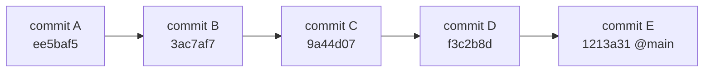
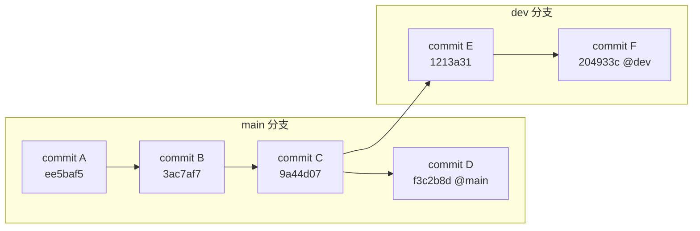
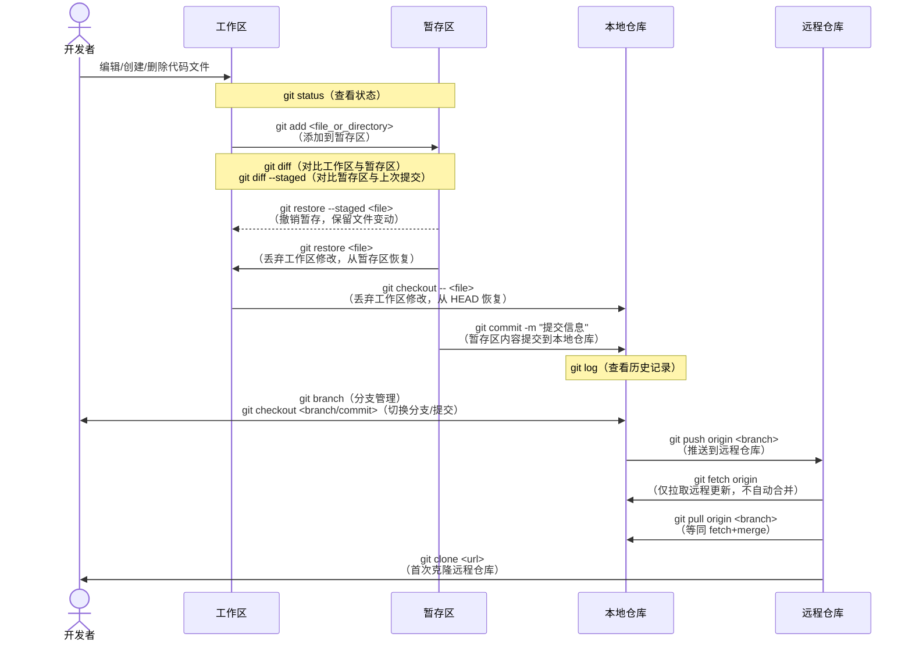

> It is easy to shoot your foot off with Git, but also easy to revert to a previous foot and merge it with your current leg.
>
> —— Jack William Bell

## Git

2005 年 4 月的一天，Linux 内核开发社区的氛围异常凝重。一直以来，Linux 内核开发者依赖 BitKeeper 这款强大的闭源版本控制工具进行协作。然而，BitKeeper 的母公司突然宣布停止向 Linux 内核社区提供免费授权。对于庞大的 Linux 内核项目而言，这无疑是一场巨大冲击：失去了合适的版本控制系统，数以千计的开发者如何高效协作？代码的演进历史又如何完整可靠地维护？

关键时刻，Linux 内核的缔造者 Linus Torvalds 挺身而出。他做出了一个极具魄力的决定：

> So I'm writing a new SCM. It's called "git". It's written in C, and it's quite fast.
>
> 所以我正在编写一个新的源代码管理工具。它叫做“git”。它是用 C 语言编写的，速度非常快。

5 天后，Git 诞生了。

### 什么是 Git

Git 是一个**分布式版本控制系统**。与 SVN、CVS 等传统集中式版本控制系统不同，Git 的核心设计理念是“去中心化”。在 Git 中，每位开发者的本地计算机上都完整保存着项目代码库的副本和全部历史记录。这意味着你可以在本地独立完成绝大部分操作（如提交、分支、查看历史），无需时刻联网。

更重要的是，Git 在设计之初就兼顾了兼容性，能够与当时主流的 Subversion (SVN) 仓库进行数据交互，使得现有项目迁移到 Git 变得更加平滑，大大降低了推广和普及门槛。

### Git 分布式代码管理核心概念

理解 Git 的分布式机制，首先要熟悉以下核心概念：

#### 提交 (Commit)

提交是 Git 中最基本的操作单元。每当你对项目文件做出修改（如添加新功能、修复 bug）并希望永久记录这些更改时，就需要执行一次“提交”。

每个提交对象主要包含：

1. **一组指向文件快照的指针**——Git 保存的是每次提交时的文件完整快照，而不是简单的差异。
2. **元数据**——如提交者、时间、提交说明（commit message）等。
3. **一个或多个父提交指针**——除了初始提交外，每个提交至少有一个父提交，指向它所基于的历史，这样便形成一条清晰的提交链。

每次提交都会生成一个 40 位的唯一 SHA-1 哈希值（如 `ee5baf5...`），用以标识该提交。通常实际使用时，只需前 7 位即可唯一定位。



简明扼要的提交信息是高效协作之本，能够帮助你和团队成员快速理解代码的演变轨迹。

#### 分支 (Branch) 与合并 (Merge)

**分支**是 Git 的灵魂所在。你可以将分支理解为一条独立的项目开发线。创建分支相当于从主线分离出一份可独立发展的拷贝，你可以在其上安全地试验新功能或修 Bug，而不会影响主分支的稳定。

Git 的分支机制极其轻量，分支其实就是一个指向某个提交对象的可移动指针。默认主分支通常叫作`main`（以前一般叫`master`）。



完成特性开发后，通常要将分支成果合并回主分支或其它目标分支，即**合并 (Merge)**。

Git 的主要合并策略：

1. **直接合并（Merge Commit / Fast-Forward Merge）**：
   - **快进合并 (Fast-Forward Merge)**：如果在建立分支后主分支没有新提交，Git 会简单地把主分支指针向前移动到特性分支头部，保持线性历史。
   - **三方合并 (Three-way Merge / Merge Commit)**：若主分支和特性分支同时有发展（如上图：`main`分支有`D`，`dev`有`E`和`F`，共同祖先为`C`），Git 会同时比较两分支各自的修改内容，创建一个新的“合并提交（Merge Commit）”。合并提交拥有两个父提交，完整保留分支的独立历史。

   对上述分支如用三方合并，将`dev`合入`main`后：

   ```mermaid
   graph LR
       A[commit A<br/>ee5baf5]
       B[commit B<br/>3ac7af7]
       C[commit C<br/>9a44d07]
       D[commit D<br/>f3c2b8d]
       E[commit E<br/>1213a31]
       F[commit F<br/>204933c @dev]
       M[merge commit M<br/>53d6a3c @main]

       A --> B
       B --> C
       C --> D
       C --> E
       E --> F
       D --> M
       F --> M
   ```

2. **变基（Rebase）**：
   变基是合并分支修改的另一方式。它会将分支上的所有提交“重放”到目标分支的新顶端。以图为例，将`dev`变基到`main`，Git 会：

   1. 找到共同祖先 (`C`)；
   2. 将`dev`分支自`C`起的所有提交提取出来（`E`、`F`）；
   3. 将`dev`分支指针重置到`main`分支最新提交（`D`）；
   4. 依次应用之前的更改，生成全新的提交（`E'`、`F'`）。

   ```mermaid
   graph LR
       A[commit A<br/>ee5baf5]
       B[commit B<br/>3ac7af7]
       C[commit C<br/>9a44d07]
       D[commit D<br/>f3c2b8d]
       E_[rebase commit E'<br/>**c140e2d**]
       F_[rebase commit F'<br/>**a1ba685** @main @dev]

       A --> B
       B --> C
       C --> D
       D --> E_
       E_ --> F_
   ```

   优点是生成线性历史，缺点则在于它**重写提交历史**（`E'`、`F'`哈希与原先不同）。**注意：**切勿对已推送到公共仓库、被他人基于的分支执行变基操作，否则会给协作者带来较大困扰。变基适用于本地分支整理历史后再与主分支合并。

3. **压缩提交（Squash Merge）**：
   特性分支开发中往往产生很多临时提交，为保持主分支历史简洁，可把它们“压缩”为唯一一次有意义的提交再合并。常用方式包括交互式变基（`git rebase -i`），或合并时使用`git merge --squash`（此时不会生成合并提交，而是将全部变化叠在工作区和暂存区，需手动再创建提交）。

   如将`dev`的`E`和`F`压缩为`S`，合入`main`：

   ```mermaid
   graph LR
       A[commit A<br/>ee5baf5]
       B[commit B<br/>3ac7af7]
       C[commit C<br/>9a44d07]
       D[commit D<br/>f3c2b8d]
       S[squash commit S=E+F<br/>**8e05a67** @main]
       E(commit E<br/>1213a31)
       F(commit F<br/>204933c @dev)

       A --> B
       B --> C
       C --> D
       D --> S

       C --> E
       E --> F

       subgraph dev 分支
           E
           F
       end
   ```

#### 工作区、暂存区、本地仓库和远程仓库

搞懂 Git 的工作流程，关键在于理解四大区域和互操作逻辑：

1. **工作区（Working Directory）**
   你实际操作和编辑项目文件的目录。

2. **暂存区（Staging Area / Index）**
   位于工作区和本地仓库之间的缓冲地带。所有修改需使用`git add`命令添加到暂存区，才会进入下一次提交。你可以选择性地添加某些修改或某些文件，实现精细控制。

3. **本地仓库（Local Repository）**
   位于`.git`文件夹内，是你的项目的完整版本数据库。所有从暂存区提交的改动，都在本地仓库永久保存。

4. **远程仓库（Remote Repository）**
   通常存储在 GitHub、GitLab 等服务器上，是团队协作的集线器。你通过`git push`将本地仓库变动同步到远程仓库，他人可通过`git pull`拉取这些变更。

下图直观展示了四大区域的流转关系及典型命令：



#### 安全性

Git 依靠 SHA-1 哈希算法保证数据完整可靠。每个提交对象拥有独特的 SHA-1 哈希码，这一哈希依据提交内容、元信息及**父提交哈希**共同计算。
你会发现，每个提交互相串联——有了链式结构，任何篡改都会影响哈希链中的所有后续提交哈希。由此，Git 可轻松检测出数据损坏或历史篡改。

> 区块链的技术原理与此类似，都是用哈希算法与链式结构确保数据难以篡改。每个区块都包含上一个区块的哈希，形成不可逆的区块链。

此外，Git 还提供了提交签名（Commit Signing）功能。开发者可用 GPG/SSH 密钥对提交进行数字签名，验证提交人的身份和内容真实性，尤在开源领域意义重大，有效防止恶意注入。

> GitHub 上有一个有趣的项目 [git-blame-someone-else](https://github.com/jayphelps/git-blame-someone-else) ，作者通过篡改提交历史伪装成 Linus Torvalds 提交，项目本身就是用来“甩锅”的工具。

## GitHub

有了强大本地版本控制的 Git 之后，我们还需要协作的平台。此时，**GitHub**应运而生。

GitHub 自 2008 年成立，是一个**基于 Git 的代码托管和开发者社区平台**。它远不只是远程仓库，更是集成了代码管理、协作、自动化等一站式开发服务，极大提升了团队和开源社群的开发效率。

### GitHub 核心功能与价值

1. **代码托管（Repositories）**
   - 支持无限的公有仓库与私有仓库，既可面向全球开放，也可团队专享。
   - **组织（Organizations）**：方便多人协作和代码权限统一管理，广泛应用于企业和大型开源项目。

2. **协作流程（Collaboration Workflow）**
   - **Fork（分叉/复刻）**：你想为某个开源项目贡献，首先要“复刻”一份到自账户下，随意修改。
   - **Pull Request（PR/拉取请求）**：改动完成后，可向原项目发起 PR。PR 不仅是提代码，也是讨论和代码审查（Code Review）的空间。维护者可审查、讨论直至质量达标合并进主干，这也是开源社区核心协作方式之一。
   - **Issues（议题）**：用于问题追踪、BUG 反馈、功能建议、任务拆解等。每个 Issue 可与 PR、里程碑和看板关联，非常适合团队协作。

3. **自动化（Workflow – GitHub Actions）**
   GitHub Actions 为 CI/CD 和各种自动化需求提供平台。可在特定事件（如推送、PR 创建、Issue 创建等）时自动运行脚本：比如自动测试、构建、部署、打包发布等。

4. **项目管理（Project Management）**
   - **Projects（项目板）**：类似看板式任务管理，助你可视化项目进度。
   - **Milestones（里程碑）**：归组相关 Issue 或 PR，对应版本或交付阶段。
   - **Wikis**：专门用作项目文档或知识库。

5. **社交与发现（Social Coding & Discovery）**
   - **Star & Watch**：Star 为收藏和点赞，Watch 可接收项目更新通知。
   - **关注用户/组织**：了解感兴趣的开发者或组织动态。
   - **贡献图（Contribution Graph）**：个人主页展示公开贡献，体现活跃度和成就。
   - **Explore & Trending**：便于发现新鲜、热门、相关兴趣的项目。

6. **GitHub Pages**
   支持直接用仓库内容托管静态网站（如项目文档、博客、主页）。只需将 HTML、CSS、JS 推送到指定分支（如`gh-pages`或`main`的`/docs`目录），或者配合 Jekyll、GitHub Actions 自动生成和发布，即可一键上线网站。

### Git 和 GitHub 的关系

- **Git 是工具，GitHub 是平台**：Git 是底层系统（可本地/私有服务器独立用），GitHub 是在此基础上包装了 Web 和协作能力的在线服务。
- **可以只用 Git 而不依赖 GitHub**：你完全可以自己搭服务器（如 GitLab、Gitea），Git 仍完全适用。
- **用 GitHub 必用到 Git**：与 GitHub 交互依赖本地 Git 命令，当然也可用桌面客户端辅助操作。

### 如何入门 GitHub

1. **注册账号**：访问 [github.com](https://github.com) 注册。
2. **安装 Git 工具**：下载安装 [git-scm.com](https://git-scm.com/) 的最新版。
3. **本地配置**

   ```bash
   git config --global user.name "Your Name"
   git config --global user.email "your.email@example.com"
   ```

4. **创建/克隆仓库**
   - 在 GitHub 新建仓库后，按引导将代码推送，或本地已有项目初始化后推送到远程。
   - 克隆仓库用：`git clone <repository_url>`
5. **日常操作**：用`git add`、`git commit`、`git push`、`git pull`、`git branch`、`git merge`等命令进行日常版本管理和协作。
6. **发起 Pull Request**：在自己分支或 Fork 开发后，通过网页界面提交 PR，进行代码合入。

### 总结

Git 凭借分布式设计、强劲的分支与合并机制及出色的性能，彻底革新了软件开发领域的版本控制。而 GitHub 基于此打造了全球最大开发者协作平台，提供高效的协作流程与强大的生态。掌握 Git 及 GitHub 已是现代开发者的必备素养，两者共同推动着开源和商业软件开发的蓬勃发展。

> 你知道吗？BitKeeper 在 2016 年最终选择开放源码，但已远不复 Git 盛况。2018 年底，BitKeeper 发布最后一个版本后便停止维护，成为历史尘埃。
